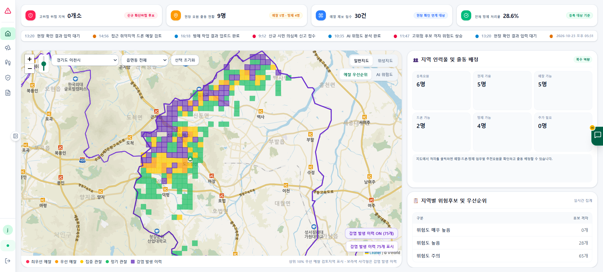
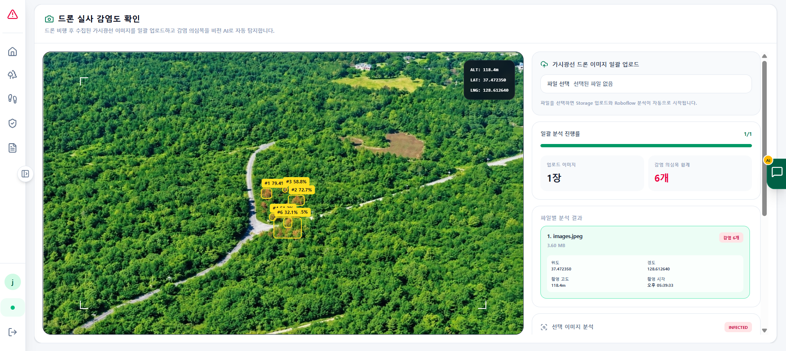
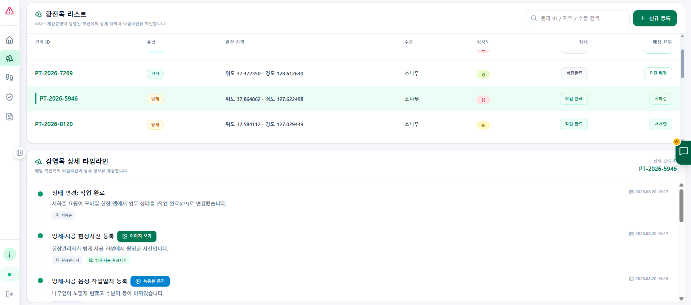
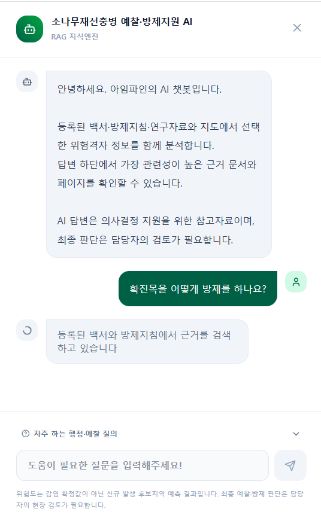
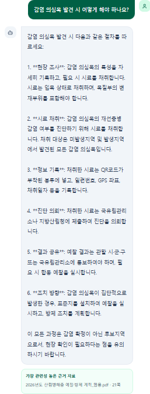
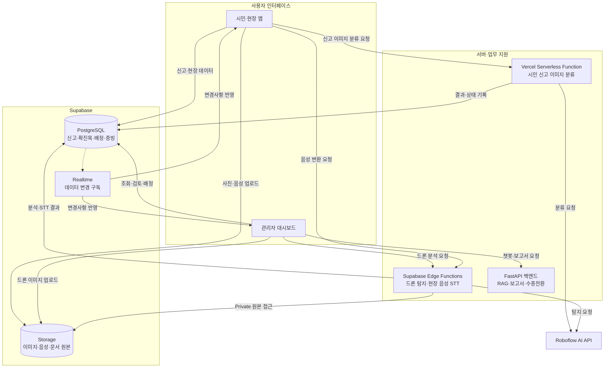
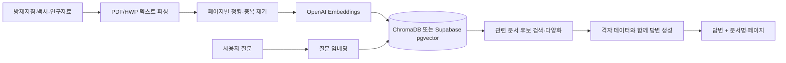

# AI 기반 소나무재선충병 통합 관제 플랫폼

> **시민 신고와 드론 이미지의 AI 분석 결과를 현장 방제·행정 업무에 연결하는 통합 관제 시스템**

| 항목 | 내용 |
| --- | --- |
| 프로젝트 | KT AIVLE School 팀 빅프로젝트 |
| 개발 기간 | 2026.06.19 ~ 2026.08.20 |
| 프로젝트 성격 | AI 분석과 현장 업무 흐름을 통합한 서비스 PoC |
| 나의 역할 | 비전 AI·RAG 챗봇 서비스 구현, 프론트엔드 통합 총괄, 서버리스·API·DB 개발 및 배포 관리 |
| 핵심 기술 | React, TypeScript, Vite, Supabase(PostgreSQL·Storage·Realtime·Edge Functions), Vercel, Roboflow, Python FastAPI |

### 핵심 기여 한눈에 보기

- **AI 서비스 구현:** Roboflow 객체 탐지를 가시광·열화상 드론 이미지 분석 화면과 연동하고, 탐지 결과를 확진목 관리 흐름에 연결했습니다.
- **서버리스·데이터 처리:** Supabase Edge Functions를 직접 개발하고 Storage·PostgreSQL의 파일·메타데이터 저장 및 예외 처리를 구현했습니다.
- **RAG 챗봇 풀스택 개발:** React 대화 UI부터 Python FastAPI 백엔드, PDF 문서 파싱·청킹, OpenAI 임베딩, 벡터 검색, 근거 기반 답변 생성 및 출처 표시까지 구현했습니다.
- **서비스 통합·배포:** 시민 신고부터 현장 배정·증빙·행정 지원 기능까지 프론트엔드와 데이터를 통합하고, GitHub `dev` 브랜치 및 Vercel 배포를 관리했습니다.



*관리자 대시보드 시연 화면. 일부 위험 격자·인력 현황 등은 프로젝트 시연용 데이터입니다.*

### 목차

- [1. 프로젝트 개요](#1-프로젝트-개요)
- [2. 주요 기능](#2-주요-기능)
- [3. 시스템 아키텍처](#3-시스템-아키텍처)
- [4. 핵심 기능과 구현 코드](#4-핵심-기능과-구현-코드)
- [5. 개발 중 문제 해결 과정](#5-개발-과정에서-마주한-문제와-해결-방법)
- [6. 구현 결과와 한계](#6-구현-결과-검증-범위와-향후-개선-과제)

## 1. 프로젝트 개요

### 1.1 배경과 문제 정의

정부기관의 소나무재선충병 방제사업 공고를 접한 뒤, 팀에서는 산림 방제 업무를 지원할 수 있는 디지털 시스템을 자체적으로 기획했습니다. **실제 정부기관으로부터 개발을 의뢰받거나 현장 요구를 직접 검증한 프로젝트는 아닙니다.**

초기에는 위험도 분석과 보고서 자동화에 초점을 맞췄지만, 분석 결과가 현장 업무에 활용되려면 신고 접수, AI 분석, 관리자 검토, 작업 배정, 증빙 기록, 행정 처리의 정보가 이어져야 한다고 판단했습니다. 이를 바탕으로 개별 기능을 하나의 업무 흐름으로 연결하는 관제 플랫폼을 개발했습니다.

### 1.2 목표

- **업무 흐름 연결:** 시민 신고 및 드론 분석 결과가 확진목 관리와 현장 작업으로 이어지도록 구성
- **데이터 추적성 확보:** 신고 원본, AI 분석 결과, 확진목 기록, 작업 이력과 증빙 간 연결 관계 유지
- **처리 상태의 가시화:** 시간이 걸리는 AI·음성 변환 작업의 진행·성공·실패 상태를 확인할 수 있도록 구현
- **시스템 통합:** 관리자 웹과 현장 앱, 데이터베이스, 파일 저장소, AI API, 업무 지원 백엔드를 연동

### 1.3 담당 역할과 협업 범위

팀에서 실제 개발을 담당한 인원은 2명이었으며, 저는 **비전 AI 서비스 구현, RAG 챗봇 프론트엔드·Python 백엔드 개발, 서버리스 기능 개발 및 프론트엔드 통합 총괄**을 맡았습니다. 비전 AI를 웹 서비스에서 호출하고 결과를 시각화하는 기능을 구현했으며, 분석 결과가 현장 업무 데이터와 연결되도록 구성했습니다.

주요 담당 작업은 다음과 같습니다.

- **비전 AI 기능 구현:** Roboflow의 이미지 분류·객체 탐지 결과를 서비스에 적용했습니다. 특히 가시광·열화상 드론 이미지 분석 결과에서 탐지 영역(바운딩 박스)과 신뢰도를 표시하고, 관리자가 탐지 결과를 검토해 확진목 관리로 연결할 수 있도록 구현했습니다.
- **서버리스 함수 직접 개발:** Supabase Edge Functions를 직접 구현하여 Private Storage의 드론 이미지가 외부 AI 분석 API에 전달되는 경로를 구성했습니다. 현장 음성 파일의 STT 연동 기능도 서버리스 방식으로 구현했습니다.
- **프론트엔드 기능 개발 및 통합:** React·TypeScript 기반 관리자 대시보드와 현장 앱의 기능을 개발·통합하고, 시민 신고에서 AI 분석, 확진목 등록, 현장 작업으로 이어지는 화면과 데이터 흐름을 연결했습니다.
- **데이터 연동 및 예외 처리:** Supabase PostgreSQL·Storage·Realtime을 이용해 신고·확진목·현장 증빙 데이터를 연동했습니다. AI 분석의 파일별 진행·성공·실패 상태를 표시하고, 중복 등록 방지와 일부 저장 흐름의 실패 복구 처리를 구현했습니다.
- **RAG 챗봇 프론트엔드·백엔드 개발:** `Chatbot.tsx`에서 대화 UI·상태·근거 문서 표시를 구현하고, `ragApi.ts`에서 FastAPI `/chat` 통신·오류 처리를 구성했습니다. Python 백엔드의 `app/api/chat.py`에서 질문 처리·격자 조회·유사도 검색을 연결하고, `app/core/`에서 문서 분할·임베딩·벡터 저장·답변 생성 기능을 구성했습니다.
- **협업 및 배포 관리:** GitHub 공동작업 규칙을 문서화하고, `dev` 브랜치를 기준으로 팀원 코드의 최종 통합과 Vercel 배포 관리를 담당했습니다.

**담당 범위 구분:** Roboflow 비전 AI 모델 자체의 개발·학습과 기존 모델을 활용한 AI 서비스 구현은 구분합니다. **RAG 챗봇은 프론트엔드와 Python 백엔드를 모두 직접 개발한 범위입니다.** 다만 프론트엔드의 선택 격자 전달 여부 등은 파일 버전 차이로 최종 동작 검증이 필요합니다. RAG와 별개인 보고서·수종전환 백엔드 전체를 단독 개발했다고 주장하지 않습니다. 시민 신고 사진 분류용 Vercel 함수(`api/roboflow.ts`)의 작성 범위도 별도 확인이 필요합니다.

## 2. 주요 기능

| 기능 | 사용자 관점의 흐름 | 주요 구현 요소 |
| --- | --- | --- |
| 시민 의심목 신고 | 사진·위치 정보를 등록하고 AI 분류 및 처리 상태 확인 | 신고 데이터 저장, Vercel Serverless Function을 통한 Roboflow 분류, 상태·오류 기록 |
| 드론 이미지 분석 | 가시광·열화상 이미지를 업로드해 감염 의심 영역 확인 | Supabase Edge Functions 호출, 바운딩 박스·신뢰도 표시, 파일별 진행 상태 관리 |
| 관리자 검토 및 확진목 관리 | 신고·탐지 결과를 검토하고 확진목 관리 항목과 연결 | 원본 신고·분석 결과·확진목 간 참조 ID 및 타임라인 관리 |
| 현장요원 업무 배정 | 예찰·방제 작업을 배정하고 단계별 진행 상태 관리 | 현장요원 업무 배정 테이블(`dispatch_assignments`)에 작업·담당자·상태·시각 기록, Realtime 연동 구조 |
| 현장 증빙 기록 | 사진·음성·GPS·QR 정보를 업무 이력에 연결 | Storage 원본 저장, DB 메타데이터 기록, 음성 STT 상태 관리 |
| RAG 업무 지원 챗봇 | 자연어 질문, 이전 대화 활용, 근거 문서 열람 | React UI, FastAPI 챗봇 API, 문서 청킹·임베딩·벡터 검색·답변 생성 및 문서명·페이지 반환 |
| 보고서·수종전환 지원 | 보고서 생성 및 수종전환 정보 활용 | 팀 FastAPI 보고서·추천 API를 프론트엔드와 통합 |
| 지도 기반 관제 | 신고·확진목·위험 정보를 공간적으로 확인 | Leaflet 기반 시각화 및 관련 상태 연결 |

### 2.1 주요 업무 흐름

1. 시민이 의심목 사진과 위치 정보를 등록하거나, 관리자가 드론 촬영 이미지를 업로드합니다.
2. 서버리스 함수가 이미지 분석 API를 호출하고 결과 및 처리 상태를 기록합니다.
3. 관리자는 분석 결과를 검토해 관리 대상 기록과 연결합니다.
4. 예찰·방제 작업을 담당자에게 배정하고 진행 상태를 관리합니다.
5. 현장요원은 사진·음성 등 증빙을 저장하고, 관리자는 처리 이력을 조회합니다.
6. 필요한 업무 데이터는 보고서 및 행정 지원 기능에 활용됩니다.

### 2.2 실제 서비스 구동 화면

**드론 비전 AI 분석 및 확진목 관리**

| 가시광 드론 이미지 AI 분석 | 확진목 목록과 작업 이력 |
| :---: | :---: |
|  |  |
| 이미지 업로드 후 Roboflow 탐지 결과를 바운딩 박스·신뢰도·파일별 진행 상태로 표시 | 관리 대상의 상태, 담당 요원, 현장 사진과 음성 작업일지를 타임라인으로 조회 |

이미지의 **탐지 신뢰도는 모델 출력 점수이지 감염 확률이나 정확도 검증 수치가 아닙니다.** 표시된 드론 위치·고도 중 일부는 시연용 값이며, 실제 개별 나무의 정밀 좌표를 자동 산출했다는 의미도 아닙니다.

**RAG 기반 관리자 업무 지원 챗봇 — 프론트엔드·Python 백엔드 개발**

| 답변 처리 중 | 근거 문서와 함께 표시된 최종 응답 |
| :---: | :---: |
|  |  |

저는 `src/components/Chatbot.tsx`의 **대화 UI·이력 관리·로딩 및 오류 표시·추천 질문·근거 문서 링크**를 구현했고, `src/services/ragApi.ts`에서 **FastAPI `/chat` 요청·응답 처리, 출처 데이터 정규화, 타임아웃·오류 처리**를 구성했습니다. 사용자는 방제 업무를 질문하고, 답변과 함께 가장 관련성이 높은 근거 문서 및 페이지를 확인할 수 있습니다.

**구현 범위:** 챗봇 UI·API 통신 및 Python 백엔드의 문서 처리·벡터 검색·답변 생성 로직을 구현했습니다. FastAPI의 `POST /chat`은 관련 문서 청크를 검색한 뒤 OpenAI API로 답변을 생성하고, 별도의 `sources` 필드에 문서명과 페이지를 반환합니다. 단, 보관된 프론트엔드 버전은 **선택 격자 컨텍스트를 API 요청에 포함하지 않아** 격자 기반 질문의 전체 연동 여부는 최종 코드 확인이 필요합니다. 실제 화면은 출처 표시 기능을 보여줄 뿐 답변 정확도나 검색 품질의 별도 정량평가 결과는 아닙니다.

<!-- 추가 화면 확보 시 넣을 위치:
현장요원 업무 배정: docs/images/04-dispatch.png
현장 앱 사진·음성 증빙: docs/images/05-field-evidence.png
-->


### 2.3 주요 기능에서 고려한 설계

**AI 작업 상태 관리:** 이미지별 `queued`·`uploading`·`analyzing`·`completed`·`error` 등의 상태를 사용해 여러 파일을 순차 분석하면서 진행 상황과 오류를 표시했습니다. 시민 신고 분류와 음성 STT도 처리 상태 및 실패 원인을 기록하도록 구성했습니다.

**파일과 데이터 분리:** 이미지·음성 원본은 Supabase Storage에 저장하고, PostgreSQL에는 파일 경로, 업무 연결 ID, 좌표 및 처리 상태 등의 메타데이터를 기록했습니다. 일부 저장 흐름에서는 DB 등록이 실패할 경우 앞서 업로드한 파일을 삭제하는 보상 처리를 적용했습니다.

**출처 추적:** 신고, AI 탐지, 확진목 및 현장 증빙을 참조 ID와 타임라인으로 연결해 원본에서 후속 조치까지 확인할 수 있도록 설계했습니다.

> **구현 범위에 관한 주의:** 실제 현장에 납품·운영한 상용 서비스가 아니라 팀 프로젝트 PoC입니다. AI 모델의 현장 성능, 개별 나무 GPS 자동 산출 정확도, 행정기관 시스템 연동은 실증되지 않았습니다. 위험 격자·인력·재고 및 일부 드론 메타데이터에는 시연용 데이터가 포함됩니다. 또한 작업 배정 Realtime 영구 저장 및 열화상 탐지 결과의 확진목 전환은 최종 배포 코드를 대조해 확인할 항목입니다.

## 3. 시스템 아키텍처

### 3.1 전체 구조



> **읽는 방법:** 시민 신고 사진 분류는 Vercel Serverless Function(`api/roboflow.ts`), 드론 분석과 음성 STT는 Supabase Edge Function을 사용합니다. 두 실행 환경을 혼동하지 않도록 구분했습니다. 다이어그램은 주요 논리 흐름을 나타내며, 실제 모든 호출 경로를 빠짐없이 표시한 배포 구성도는 아닙니다.

### 3.2 기술 스택과 선택 역할

| 계층 | 기술 | 프로젝트에서 사용한 용도 |
| --- | --- | --- |
| 프론트엔드 | React, TypeScript, Vite | 관리자 대시보드·현장 앱 UI 및 상태 연동 |
| 지도 | Leaflet, react-leaflet | 신고·확진목·위험 격자 시각화 |
| 데이터베이스 | Supabase PostgreSQL | 신고·확진목·작업 배정·증빙 메타데이터 관리 |
| 원본 파일 저장 | Supabase Storage | 시민 신고·드론·현장 사진과 음성 파일 관리 |
| 실시간 데이터 | Supabase Realtime | 신고·작업 데이터 변경 이벤트 구독 |
| 서버리스 | Vercel Serverless Functions | 시민 신고 이미지 분류 및 서버 측 비밀키 사용 |
| 서버리스 | Supabase Edge Functions | Private Storage 기반 드론 이미지 분석·음성 STT 호출 |
| AI 서비스 | Roboflow | 이미지 분류 및 가시광·열화상 객체 탐지 |
| 업무 지원 API | Python FastAPI, OpenAI API | 직접 개발한 RAG 챗봇과 팀의 보고서·수종전환 기능 연동 |
| RAG 문서 검색 | PyMuPDF, OpenAI Embeddings, ChromaDB / Supabase pgvector | 문서 파싱·청킹·임베딩, 저장소 설정에 따른 벡터 유사도 검색 |
| RAG 답변 생성 | OpenAI Chat Completions | 문서 근거와 위험 격자 정보를 결합한 질문·응답 처리 |
| 배포·협업 | Vercel, Supabase, GitHub | 웹 서비스 배포, 백엔드 서비스 관리, 코드 통합 |

### 3.3 주요 데이터 및 저장 구조

| 데이터 | 저장 위치 | 목적 |
| --- | --- | --- |
| `pine_records` | PostgreSQL | 시민 신고와 이미지 분류 결과·상태 |
| `confirmed_trees` | PostgreSQL | 확진목 관리 항목과 분석 출처·타임라인 |
| `dispatch_assignments` | PostgreSQL | 현장요원에게 배정된 예찰·방제 작업과 진행 상태·처리 시각 |
| `field_photos` | PostgreSQL | 현장 사진의 업무 연결 관계 및 메타데이터 |
| `field_voice_logs` | PostgreSQL | 음성 파일 경로, STT 결과 및 처리 상태 |
| `pine-images` | Storage | 시민 신고 원본 사진 |
| `drone-images` | Storage (Private) | 가시광·열화상 드론 원본 사진 |
| `field-photos`, `field-audio` | Storage (Private) | 현장 증빙 사진 및 음성 원본 |

파일의 실데이터는 Storage에, 이를 검색·추적하기 위한 정보를 PostgreSQL에 저장하는 구조입니다. Private 버킷의 파일에 접근하거나 외부 AI API를 호출할 때는 브라우저에서 비밀키를 직접 노출하지 않도록 서버 측 처리 계층을 사용했습니다.

---

## 4. 핵심 기능과 구현 코드

이 장에서는 시스템 전체를 소개하는 데 그치지 않고, **제가 담당한 AI 서비스 연동, 프론트엔드 구현, 데이터 처리 및 기능 통합**을 코드 흐름으로 설명합니다. 아래 코드는 당시 보관한 TypeScript/TSX 코드의 핵심 부분을 발췌·축약했습니다. 일부 주석은 흐름을 설명하기 위해 추가했습니다. 외부 AI 모델 학습이나 팀원이 작성한 백엔드 전체를 제 단독 개발 범위로 포함하지 않습니다.

### 4.1 드론 이미지 분석: Storage 업로드와 비전 AI 호출

**해결하려던 문제**

관리자가 드론 이미지를 업로드한 뒤 AI 분석 결과를 확인하고, 여러 이미지의 처리 상황을 파일별로 파악할 수 있어야 했습니다. 또한 드론 원본이 Private Storage에 저장되므로 브라우저에서 비밀키를 사용해 Roboflow를 직접 호출하지 않는 구조가 필요했습니다.

**구현 흐름**

1. 사용자가 가시광 또는 열화상 드론 이미지를 선택합니다.
2. 원본 이미지를 Supabase Storage의 `drone-images` 버킷에 업로드합니다.
3. 업로드된 파일의 `bucket`, `path`를 Supabase Edge Function에 전달합니다.
4. 함수가 돌려준 `predictions`를 프론트엔드에서 해석하여 탐지 영역과 신뢰도를 표시합니다.
5. 이미지별 `queued`, `uploading`, `analyzing`, `completed`, `error` 상태를 갱신합니다.

**가시광 이미지 분석 함수 호출 — `DroneVisionAnalysisSection.tsx`**

```tsx
const { data, error } =
  await supabase.functions.invoke<VisionDetectionResult>(
    "drone-visible-detection",
    {
      body: {
        bucket: DRONE_BUCKET,
        path: storagePath,
        confidence: 15,
        overlap: 30,
      },
    },
  );
```

가시광 이미지는 `drone-images/visible/날짜/UUID.확장자` 형태로 저장하며, `upsert: false`로 기존 파일을 덮어쓰지 않도록 했습니다. 여러 이미지가 들어오면 `analyzeBatch`의 반복문에서 **업로드와 분석을 순차 실행**하고, `finally`에서 처리 완료 건수를 갱신합니다.

**열화상 이미지 분석 — `ThermalAnalysisSection(1).tsx`**

열화상 분석도 같은 흐름이지만 `thermal-detection` Edge Function을 호출하고 `drone-images/thermal/날짜/UUID.확장자` 경로를 사용합니다. 당시 호출 인자는 `confidence: 10`, `overlap: 30`이었습니다. 이는 **분석 API에 전달한 설정값**이지, 모델 정확도나 탐지 성능의 검증 수치가 아닙니다.

**분석 결과를 화면에 표시하는 방법**

Roboflow 객체 탐지 결과의 `x`, `y`는 탐지 상자의 중심 픽셀 좌표입니다. 따라서 화면에 상자를 표시할 때 중심점에서 너비·높이의 절반을 빼고, 원본 이미지 크기에 대한 비율(%)로 변환했습니다.

```tsx
const left =
  ((prediction.x - prediction.width / 2) / sourceImageWidth) * 100;
const top =
  ((prediction.y - prediction.height / 2) / sourceImageHeight) * 100;
const width = (prediction.width / sourceImageWidth) * 100;
const height = (prediction.height / sourceImageHeight) * 100;
```

이 계산을 통해 이미지가 화면 크기에 맞게 축소되어도 탐지 상자를 상대적 위치에 표시할 수 있습니다. 함수 요청 오류는 `FunctionsHttpError`, `FunctionsRelayError`, `FunctionsFetchError`를 구분해 사용자에게 오류 원인을 표시했습니다.

**담당 범위:** 이미지 업로드·호출·응답 처리·상태 표시·바운딩 박스 UI는 보관된 프론트엔드 코드에서 확인됩니다. Edge Function의 서버 측 구현을 직접 담당했다는 점은 프로젝트 수행 기록에 근거하며, **각 함수의 `index.ts` 전문은 최종 저장소와 재대조할 예정**입니다.

### 4.2 탐지 결과를 확진목 관리 흐름과 연결

**해결하려던 문제**

AI가 이미지에서 의심 객체를 탐지하더라도 그 결과가 화면에만 남으면 후속 관리에 활용하기 어렵습니다. 그래서 탐지 결과를 관리 대상 데이터로 전환하면서 원본 이미지와 분석 결과의 출처를 함께 남기도록 구현했습니다.

**구현한 데이터 연결**

- `predictions`의 각 객체에 대해 신뢰도를 백분율로 변환했습니다.
- 객체별 관리 레코드(`TreeRecord`)를 만들고 `onAddTree`를 통해 상위 관리 흐름에 전달했습니다.
- `sourceReportId`에 Storage 경로와 객체 인덱스를 조합해 분석 결과의 출처를 식별했습니다.
- `analysisResult`에 탐지 결과 원본, 이미지 크기, Storage 위치, 선택한 객체 인덱스를 저장하도록 구성했습니다.
- 현재 분석 화면에서 같은 이미지를 반복 전환하지 않도록 `Set`으로 전환 여부를 관리했습니다.

**원본 추적용 식별자 — `DroneVisionAnalysisSection.tsx`**

```tsx
sourceReportId:
  `drone-visible:` +
  `${storagePath}:` +
  `${index}`,
```

가시광 분석 코드에는 탐지 결과를 관리 항목으로 전환하는 로직이 확인되며, 열화상 분석 화면의 다른 보관 버전에도 유사한 처리 코드가 있습니다. 다만 위 `Set` 방식은 **해당 화면 상태 안에서의 중복 전환 방지**이며, 데이터베이스의 고유 제약조건으로 모든 중복을 막았다는 의미는 아닙니다. 실제 PostgreSQL 저장은 `onAddTree`를 처리하는 상위 로직까지 함께 확인해야 합니다.

> **검증 범위:** 시연 코드의 드론 GPS·고도·촬영 시각 일부는 생성된 값입니다. 객체별 위경도 또한 기준 좌표에 작은 오프셋을 더한 값으로, 드론의 촬영 자세·카메라 모델을 반영해 **실제 개별 나무 위치를 정밀 산출한 기능은 아닙니다.** 또한 프로젝트 내부의 '확진목 전환'은 업무 관리 레코드 생성 기능을 가리키며, AI 예측만으로 실제 감염을 확진했다는 뜻이 아닙니다.

### 4.3 Storage와 PostgreSQL을 연계한 현장 사진 저장

**해결하려던 문제**

현장 사진의 원본 파일은 Storage에 저장하고, 어떤 업무의 증빙인지 나타내는 메타데이터는 PostgreSQL에 저장했습니다. 이 둘은 별도의 요청이기 때문에 파일 업로드 후 DB 등록에 실패하면 **참조되지 않는 원본 파일**이 남을 수 있습니다.

**구현 흐름 — `useSupabase.ts`의 `saveFieldPhoto`**

1. 업무 유형(`surveillance`/`control`)과 날짜·UUID를 사용해 Storage 경로를 생성합니다.
2. `field-photos` 버킷에 사진 원본을 업로드합니다.
3. `field_photos` 테이블에 업무 연결 ID, 파일 경로, 좌표, 촬영 시각을 등록합니다.
4. DB 저장에 실패하면 앞서 업로드한 원본을 삭제하는 보상 처리를 수행합니다.

**DB 저장 실패 시 보상 처리 — 실제 코드 발췌**

```ts
const { error: insertError } = await supabase
  .from('field_photos')
  .insert({
    related_record_id: relatedRecordId,
    work_mode: workMode,
    storage_path: storagePath,
    latitude,
    longitude,
    captured_at: new Date().toISOString(),
  });

if (insertError) {
  const { error: removeError } = await supabase.storage
    .from('field-photos')
    .remove([storagePath]);
  // 실제 코드에서는 오류 정보를 출력하고 실패를 반환합니다.
}
```

이는 분산 트랜잭션을 구현한 것이 아니라, **실패한 두 번째 작업을 감지해 앞선 업로드를 되돌리려는 보상 처리**입니다. 파일 삭제 자체도 실패할 수 있으므로 해당 오류를 로그로 남겼습니다.

### 4.4 음성 작업일지: STT 상태 및 실패 이력 보존

현장 앱은 녹음한 음성을 `field-audio` Storage에 업로드한 뒤 `field_voice_logs` 테이블에 `processing` 상태로 먼저 기록합니다. 이후 `field-audio-stt` Edge Function을 호출해 변환된 텍스트를 저장합니다.

**STT 호출 — `useSupabase.ts`**

```ts
const { data: sttData, error: sttInvokeError } =
  await supabase.functions.invoke<FieldAudioSttResponse>(
    'field-audio-stt',
    {
      body: {
        bucket: 'field-audio',
        path: storagePath,
      },
    },
  );
```

- **성공:** `transcript`를 저장하고 `stt_status`를 `completed`로 갱신합니다.
- **실패:** `stt_status`를 `error`로 갱신하고 `stt_error`에 실패 원인을 기록합니다.
- **DB 행 생성 실패:** 업로드한 원본 파일을 삭제합니다.
- **STT 처리 실패:** 원본 음성은 보존합니다. 나중에 재처리할 수 있는 여지를 남기기 위한 설계이며, **자동 재시도 기능까지 구현했다는 의미는 아닙니다.**

사진과 음성은 모두 파일·메타데이터를 분리하지만, 음성은 변환 실패 후에도 원본이 필요하므로 실패 단계에 따라 삭제 여부를 다르게 처리했습니다.

### 4.5 현장 업무 배정: Realtime과 상태 변경 복구

현장 업무 배정 데이터는 `dispatch_assignments` 테이블에서 관리했습니다. 보관된 후기 버전 `useSupabase(4).ts`에서는 예찰(`SURVEY`)·방제(`CONTROL`) 업무를 조회하고, Realtime으로 변경 이벤트를 구독하는 코드가 확인됩니다.

**실시간 변경 구독 — `useSupabase(4).ts`**

```ts
const channel = supabase
  .channel('app-dispatch-assignments')
  .on(
    'postgres_changes',
    {
      event: '*',
      schema: 'public',
      table: 'dispatch_assignments',
    },
    payload => {
      // 실제 코드에서는 DELETE를 제거 처리하고,
      // INSERT/UPDATE는 assignmentId 기준으로 병합합니다.
    },
  )
  .subscribe();
```

상태 변경 시에는 화면 상태를 먼저 바꾸는 **낙관적 업데이트(optimistic update)**를 적용했습니다. 이어서 DB에 `status`와 각 단계의 처리 시각을 기록하고, 실패하거나 변경 대상 행이 없으면 이전 상태로 되돌립니다. 서버가 실제로 갱신해 돌려준 행으로 최종 화면 상태를 확정하는 처리도 있습니다.

이 방식으로 **화면의 즉각적인 반응성과 DB 저장 결과의 일치 여부**를 함께 고려했습니다.

> **버전 확인 필요:** 초기 프로젝트 인수인계 기록에는 업무 배정이 React 메모리 상태였던 시점이 있으며, 후기 코드에는 DB 영구 저장과 Realtime이 구현돼 있습니다. 최종 배포에 어느 버전이 반영됐는지는 Git `dev` 브랜치의 이력과 비교한 뒤 확정하겠습니다.

### 4.6 시민 신고 사진 분류와 팀 백엔드 연동 범위

시민 앱의 `pine_records` 신고 사진은 Vercel Serverless Function인 `api/roboflow.ts`를 통해 Roboflow 분류 모델에 전달하도록 구성했습니다. 보관된 함수 코드에는 이미지 다운로드·Base64 변환, 분류 결과 정규화, `processing`·`completed`·`failed` 상태 및 오류 메시지 DB 갱신이 포함돼 있습니다.

이 함수는 **Supabase Edge Function이 아니라 Vercel Serverless Function**입니다. 프로젝트 전체 기능으로서 설명하되, 해당 파일의 개인별 작성 범위는 확정되지 않아 이 장에서 제 단독 구현으로 주장하지 않습니다. FastAPI 백엔드 중 **RAG 챗봇 관련 기능은 직접 개발했다고 확인**했으며, 보고서·수종전환 기능은 별개 업무로 구분합니다. 챗봇 프론트엔드와 백엔드의 소스 구조는 다음 절들에서 설명합니다.

---

### 4.7 RAG 업무 지원 챗봇: 프론트엔드와 API 통신 모듈 구현

관리자가 방제지침과 관련 자료를 자연어로 질문하고, 답변 및 근거 문서를 확인할 수 있도록 챗봇 인터페이스를 개발했습니다. **본인이 직접 작성한 것으로 확인된 프론트엔드 구성은 `src/components/Chatbot.tsx`와 `src/services/ragApi.ts`입니다.**

**처리 흐름**

1. 사용자가 질문을 입력하거나 추천 질문을 선택합니다.
2. UI는 이전 사용자·어시스턴트 메시지를 `role`·`content` 구조로 정리합니다.
3. `ragApi.ts`의 `askRagChat()`가 질문과 대화 이력을 FastAPI `POST /chat`으로 전달합니다.
4. 응답의 `answer`와 `sources`를 정규화하여 챗봇 화면에 표시합니다.
5. 사용자가 근거 문서를 선택하면 `getRagSourceUrl()`로 문서 열람 주소를 생성합니다.
6. 요청 중에는 로딩 상태를 표시하고, 연결 오류나 응답 지연 시 오류 메시지를 보여줍니다.

`Chatbot.tsx`에 구현된 메시지 전송과 응답 처리의 핵심 부분입니다.

```tsx
const history: ChatHistoryItem[] = messages
  .filter((message) => message.id !== "initial")
  .map((message) => ({ role: message.role, content: message.text }));

setIsLoading(true);
try {
  const result = await askRagChat(text, history);
  setMessages((previous) => [
    ...previous,
    {
      id: crypto.randomUUID(),
      role: "assistant",
      text: result.answer,
      sources: Array.isArray(result.sources) ? result.sources.slice(0, 1) : [],
    },
  ]);
} catch (error) {
  // 사용자에게 연결 실패 원인을 표시하는 별도 메시지를 추가
} finally {
  setIsLoading(false);
}
```

위 코드는 **현재 확인된 API 호출 규약을 설명하기 위해 두 파일의 공통 동작을 발췌·정리한 예시**이며, 보관된 원본 파일과 줄 단위로 동일한 복사본은 아닙니다. 완전한 코드는 최종 프로젝트 저장소에서 확인할 수 있습니다.

`ragApi.ts`에는 **90초 요청 타임아웃**, 응답 형식 점검, 출처 문서 속성 정규화, HTTP 오류 및 통신 실패 처리도 포함돼 있습니다. 이로써 UI가 서버의 응답 구조 차이와 오류 상황을 구분해 표시할 수 있도록 했습니다.

> **최종 소스 확인 필요:** 보관된 `Chatbot.tsx`는 격자 컨텍스트를 세 번째 인수로 전달하지만, 함께 보관된 `ragApi.ts`의 `askRagChat()` 정의는 두 인수만 받습니다. 두 파일이 동일한 시점의 최종 버전인지 확인하기 전에는 **선택 격자 컨텍스트가 실제 RAG 검색에 반영됐다고 단정하지 않습니다.**

### 4.8 RAG 챗봇: Python 백엔드 구현과 코드 분석

관리자가 소나무재선충병 관련 질문에 근거 기반 답변을 받을 수 있도록 **문서 전처리부터 RAG 검색, 답변 생성, 출처 표시까지 Python 백엔드를 구현**했습니다. 아래는 `rag-backend`의 Python 소스코드에 근거한 설명입니다.

**주요 소스 파일**

| 파일 | 구현 내용 |
| --- | --- |
| `rag-backend/ingest.py` | PDF·HWP·HWPX 대상 문서 파싱 → 청킹 → 임베딩 → 벡터 저장·처리 결과 집계 |
| `app/core/parsers.py` | PDF의 페이지별 텍스트 추출, 텍스트 캐시 사용, 반복 머리말·페이지 번호 제거 및 HWP 계열 문서 처리 |
| `app/core/chunker.py` | 문서별·페이지별 텍스트를 1,000자 단위로 나누고 200자씩 중첩, 80자 미만 및 중복 청크 제외 |
| `app/core/embedder.py` | OpenAI `text-embedding-3-small` 임베딩, 최대 64건 단위 배치 및 Rate Limit 재시도 |
| `app/core/store.py` | 기본 ChromaDB 벡터 저장·코사인 검색, 결과별 문서 수 제한, 저장소 구현 선택 |
| `app/core/supabase_store.py` | Supabase pgvector 저장·검색을 위한 DB RPC(`match_document_chunks`) 어댑터 |
| `app/api/chat.py` | `POST /chat` 질문 검증, 벡터 검색, 선택·지정 격자 정보 처리, 생성 결과와 근거 반환 |
| `app/core/generator.py` | 문서·격자 컨텍스트 결합, OpenAI Chat Completions 호출, 출처 중복 제거 |
| `app/api/docs.py` | 참고 문서 접근을 위한 5분 유효 Signed URL 생성 |

**문서 처리와 검색 파이프라인**



1. `ingest.py`가 문서 폴더의 PDF·HWP·HWPX 파일을 읽고, `parsers.py`가 페이지별 텍스트를 추출합니다. 반복되는 머리말·꼬리말과 페이지 번호를 제거해 검색용 문서 내용을 정리했습니다.
2. `chunker.py`는 기본 1,000자 청크와 200자 중첩을 적용하며, 짧거나 중복되는 청크는 제외합니다. 각 청크에 **문서명·페이지 번호**를 보존합니다.
3. `embedder.py`는 `text-embedding-3-small`을 사용하고, `store.py`는 **ChromaDB를 기본값**으로 지원합니다. `VECTOR_BACKEND=supabase` 설정 시 `supabase_store.py`의 **pgvector RPC 기반 저장소**로 전환하는 구조입니다. **실제 배포에서 어느 저장소를 사용했는지는 아직 확인하지 못했습니다.**
4. `/chat`은 질문 임베딩으로 관련 문서 후보를 검색합니다. 최대 24개 후보(기본 `k=8`의 3배)를 조회한 뒤 `diversify()`에서 **한 문서당 3개 이하**, 최종 **8개 이하의 근거 청크**를 선택합니다.
5. `generator.py`는 최근 대화 이력 최대 6건, 검색 문서 근거, 선택 격자 데이터가 제공된 경우 그 분석값을 프롬프트에 포함해 답변을 생성합니다. 기본 생성 모델은 `gpt-4o-mini`이며 환경변수로 변경할 수 있습니다.
6. 검색 결과에서 **문서명과 페이지 번호의 중복을 제거**해 `answer`와 `sources`로 반환합니다. 챗봇 UI에서는 관련 근거 문서 링크를 보여줍니다.

**지도 데이터와 연결되는 RAG 확장**

`chat.py`에는 질문의 격자 ID를 추출하거나 요청으로 전달된 `grid_context`를 서버의 GeoJSON 인덱스와 대조해 보강하는 로직이 있습니다. 이를 통해 격자별 위험도, 예찰 우선순위, 소나무류 비율, 접근성 등을 문서 근거와 함께 답변에 사용할 수 있도록 설계했습니다. 위험도 점수를 감염 확진으로 혼동하지 않도록 시스템 프롬프트에도 제약을 두었습니다.

> **실제 연동 확인 범위:** Python 백엔드는 `grid_context`를 지원하지만, 현재 보관된 `ragApi.ts`의 요청 본문에는 `question`, `history`만 포함됩니다. 반면 `Chatbot.tsx`는 세 번째 인수로 격자 컨텍스트를 넘깁니다. 따라서 **격자 데이터를 프론트엔드에서 최종 전달하는 기능은 이 코드 사본만으로 정상 동작했다고 주장하지 않습니다.** 일반 문서 기반 챗봇의 답변·출처 표시는 사용자가 제공한 실제 구동 화면에서 확인됩니다.

**코드와 검증의 구분:** 위 사항은 제공된 Python **소스의 구현 내용**을 확인한 결과입니다. 전체 환경을 직접 실행하거나, 검색 성능·답변 정확도·응답시간을 수치로 측정한 것은 아닙니다. 또한 같은 백엔드 폴더에 있는 보고서 생성·수종전환 관련 기능 전체를 개인 작업 범위에 포함하지 않았습니다.

---

_코드 검증 기준: 보관된 `DroneVisionAnalysisSection.tsx`, `ThermalAnalysisSection(1).tsx`, `useSupabase.ts`, `useSupabase(4).ts`, `roboflow(2).ts`, `Chatbot.tsx`, `ragApi.ts`, **`rag-backend`의 Python 소스코드**, 2026-10-13 기술기록. 이 파일들은 당시 코드 사본이며 현재 원격 저장소의 최신 버전과는 차이가 있을 수 있습니다. 본문에 제시된 코드는 중요한 부분의 발췌이고, 일부 스니펫의 주석은 맥락 설명을 위해 덧붙였습니다._

## 5. 개발 과정에서 마주한 문제와 해결 방법

이 장에서는 **실제로 발생한 오류를 수정한 사례**와 **실패 상황을 고려해 설계한 기능**을 구분해 설명합니다. 두 경우 모두 동작 원리와 코드를 중심으로 작성했으며, 측정하지 않은 성능 개선 수치는 사용하지 않았습니다.

### 5.1 배포 환경에서 발생한 챗봇 API 호출 실패 — 실제 오류 해결

**상황**

관리자 화면과 FastAPI 기반 업무 지원 기능을 통합하는 과정에서, 로컬 개발 환경을 기준으로 설정된 API 주소가 배포용 코드에 남아 **배포 환경에서 챗봇 API 호출이 실패하는 문제**가 있었습니다. 또한 프론트엔드 배포 주소에 맞춘 CORS 설정이 필요했습니다.

**원인 및 대응**

- 프론트엔드 코드의 API 요청 주소가 로컬 서버를 가리키는지 확인했습니다.
- 환경별 API 기본 주소를 분리하고 배포 시 올바른 백엔드 주소를 사용하도록 연결했습니다.
- FastAPI의 CORS 허용 목록에 배포 프론트엔드 주소를 반영하고 환경변수 설정을 점검했습니다.

**결과와 의미**

배포 환경에서 백엔드 API를 호출할 수 있도록 연동 설정을 수정했습니다. 이 경험을 통해 **로컬에서의 기능 구현과 운영·배포 환경에서의 정상 동작은 별도로 검증해야 한다**는 점을 배웠습니다.

> **증빙 범위:** 이 사례의 장애 현상과 수정 내용은 당시 프로젝트 기술기록에 남아 있습니다. 관련 API 설정 코드의 변경 전후 diff와 배포 로그는 현재 자료에서 직접 대조하지 못했으므로, GitHub에 공개할 때 가능하면 해당 커밋을 연결하겠습니다.

### 5.2 여러 드론 이미지 분석 중 상태와 오류를 구분 — 운영을 고려한 UI 설계

**문제 정의**

여러 드론 이미지를 순차 분석할 때 단일 로딩 표시만 사용하면, 관리자가 어떤 파일이 업로드 중인지, 분석 중인지, 실패했는지 구분하기 어렵습니다. 이미지 한 장의 분석 실패가 전체 목록의 진행 상황을 불명확하게 만드는 문제도 고려해야 했습니다.

**구현 방법**

`DroneVisionAnalysisSection.tsx`에서 이미지마다 별도 처리 상태를 두고 `queued` → `uploading` → `analyzing` → `completed` 또는 `error`로 변경했습니다. 업로드나 Edge Function 호출이 실패하면 해당 이미지에 오류 메시지를 남기고, `finally`에서 처리 완료 건수를 갱신해 다음 이미지의 분석을 이어가도록 했습니다.

```tsx
// DroneVisionAnalysisSection.tsx — 오류 처리 부분 발췌
} catch (error) {
  console.error(
    `실사 드론 이미지 분석 실패: ${item.file.name}`,
    error,
  );
  updateProcess(item.id, {
    status: "error",
    error:
      error instanceof Error
        ? error.message
        : "분석 중 오류가 발생했습니다.",
  });
} finally {
  setBatchProgress((previous) => ({
    ...previous,
    completed: previous.completed + 1,
  }));
}
```

화면에서는 파일별 분석 상태, 오류 메시지, 전체 진행률, 경과 시간 등을 확인할 수 있도록 했습니다. Supabase 함수 호출 오류도 HTTP·Relay·Fetch 오류 유형에 따라 메시지를 구분했습니다.

**결과와 의미**

파일별 성공·실패를 분리해 **부분 실패가 발생해도 처리 내역을 확인할 수 있는 구조**를 갖췄습니다. 단, 화면에 표시한 진행률은 배치 항목 처리 현황이며, AI 모델 내부의 추론 진행률이나 성능 향상 수치를 의미하지 않습니다.

### 5.3 Storage 업로드 이후 DB 저장 실패에 대응 — 데이터 일관성을 위한 보상 처리

**문제 정의**

현장 사진은 Storage에 원본 파일을 올리고 PostgreSQL에 업무 연결 정보와 파일 경로를 저장합니다. 두 작업은 별도의 API 요청이므로, **파일 업로드만 성공하고 DB 행 생성이 실패하면 참조되지 않는 파일이 남을 수 있습니다.**

**구현 방법**

`useSupabase.ts`의 `saveFieldPhoto`에서는 Storage 업로드 후 `field_photos` 테이블에 메타데이터를 등록하고, DB 등록 실패 시 업로드했던 파일을 삭제하도록 처리했습니다.

```ts
// useSupabase.ts — 실패 시 복구 경로 발췌
if (insertError) {
  const { error: removeError } =
    await supabase.storage
      .from('field-photos')
      .remove([storagePath]);

  if (removeError) {
    console.warn(
      'DB 저장 실패 후 사진 정리 실패:',
      removeError
    );
  }

  return false;
}
```

**결과와 의미**

DB 저장 실패 시 **파일 삭제를 시도하고 삭제 실패까지 로그로 남기는 복구 경로**를 구현했습니다. 이것은 Storage와 DB를 하나의 트랜잭션으로 묶었다는 뜻은 아닙니다. 실제 삭제 요청도 실패할 수 있으므로, 상용 환경이라면 주기적인 고아 파일 정리 등 추가 대책이 필요합니다.

### 5.4 음성 STT 실패 시 원본을 보존하고 원인을 기록 — 재처리를 고려한 설계

**문제 정의**

현장 작업일지 음성은 외부 STT 처리를 거치므로 네트워크·함수 호출·응답 데이터 문제 등으로 변환에 실패할 수 있습니다. 이때 원본 음성을 삭제하면 현장요원이 다시 녹음해야 할 수 있습니다.

**구현 방법**

`saveFieldVoiceLog`에서 음성을 Storage에 업로드한 뒤 `field_voice_logs`에 `processing` 상태를 먼저 등록했습니다. 변환에 성공하면 텍스트와 `completed` 상태를 기록하고, 실패하면 `stt_status: 'error'`와 오류 메시지를 저장했습니다.

```ts
// useSupabase.ts — STT 실패 기록 부분 발췌
const { error: errorUpdateError } = await supabase
  .from('field_voice_logs')
  .update({
    stt_status: 'error',
    stt_error: errorMessage,
  })
  .eq('id', insertedLog.id);
```

DB 행 생성 자체가 실패한 경우에는 이미 업로드한 음성을 삭제하지만, **STT 단계에서 실패한 경우에는 음성 원본을 보존**하도록 처리했습니다.

**결과와 의미**

처리 실패의 원인을 남기고 원본을 보존해 **추후 수동 재처리를 검토할 수 있는 구조**를 구현했습니다. 자동 재시도 큐나 재처리 관리 화면의 완성까지 주장하지는 않습니다.

### 5.5 공동 개발 과정의 기능 중복 및 통합 혼선 — 협업 방식 개선

**상황**

팀에서 실제 개발을 담당한 인원은 두 명이었습니다. 저는 프로젝트 초기에 GitHub 공동작업 규칙을 문서화했지만, 개발 중 다른 개발자가 제가 진행하던 기능을 사전 협의 없이 별도로 구현해 프로젝트에 반영하면서 **기능 중복과 최종 통합 책임을 둘러싼 혼선**이 발생했습니다.

**대응**

상대 개발자의 기여를 부정하기보다, 각자 개발은 이어가되 **최종 코드 반영과 통합은 한 명이 관리**하도록 협의했습니다. 이후 `dev` 브랜치를 통합 기준으로 삼아 변경사항 검토와 기능 연결, Vercel 배포를 관리했습니다.

**결과와 의미**

팀원이 조정된 협업 방식에 협조했고, 역할 충돌을 관리하면서 프로젝트를 마무리할 수 있었습니다. 이 경험은 단순한 Git 사용 경험이 아니라 **팀 프로젝트의 변경사항을 어떤 기준과 책임 구조로 통합할 것인가**를 고민한 사례입니다.

> **범위 구분:** 이 사례는 실제로 있었던 개발 협업 갈등에 관한 것으로, 동료가 제 기존 코드를 직접 수정했다는 뜻은 아닙니다. 커밋·PR 수나 충돌 감소율처럼 별도로 집계하지 않은 수치는 제시하지 않았습니다.

---

## 6. 구현 결과, 검증 범위와 향후 개선 과제

### 6.1 구현 결과

프로젝트의 핵심 결과는 **비전 AI 분석 기능을 개별 데모로 남겨두지 않고, 신고·관리자 검토·현장 배정·증빙·행정 기능과 연결되는 하나의 업무 흐름으로 구성했다는 점**입니다.

구현·통합한 주요 기능은 다음과 같습니다.

| 구분 | 구현·통합 결과 | 확인 근거 |
| --- | --- | --- |
| 드론 비전 AI | 가시광·열화상 이미지 업로드, Edge Function 호출, 탐지 영역·신뢰도 표시 | `DroneVisionAnalysisSection.tsx`, `ThermalAnalysisSection(1).tsx` 보관 코드 |
| 분석 상태 관리 | 파일별 업로드·분석·완료·오류 상태와 배치 진행 현황 표시 | `DroneVisionAnalysisSection.tsx` 보관 코드 |
| AI 결과의 업무 연결 | 가시광 탐지 객체의 관리 레코드 변환과 분석 원본 정보 보존 | `DroneVisionAnalysisSection.tsx` 및 프로젝트 기술기록 |
| 현장 증빙 | 사진·음성 원본과 업무 메타데이터 저장, 실패 시 파일 정리·STT 오류 기록 | `useSupabase.ts` 보관 코드 |
| 업무 배정 및 상태 동기화 | 현장 배정 데이터 CRUD, 상태 변경·시각 기록, Realtime 구독 및 실패 복구 | 후기 `useSupabase(4).ts` 보관 코드. 최종 배포 버전 재확인 필요 |
| RAG 챗봇 풀스택 | React UI, FastAPI `/chat`, PDF/HWP 문서 처리, 임베딩·벡터 검색, OpenAI 답변 생성, 출처 문서·페이지 반환 | `Chatbot.tsx`, `ragApi.ts`, `rag-backend/app/api/chat.py`, `app/core/*`, `ingest.py` 소스 및 답변 화면 확인. 프론트 격자 컨텍스트 전달은 추가 확인 필요 |
| 관리자 업무 지원 통합 | 지도·보고서·추천 등 팀 기능을 관리자 서비스에 통합 | 프로젝트 기술기록. 서버 내부 원천 개발 범위는 별도 구분 |
| 협업·배포 | `dev` 브랜치 중심 기능 통합과 Vercel 배포 관리 | 프로젝트 수행 기록 |

위 표의 **'코드에서 구현 확인'과 '실제 배포 환경에서 검증 완료'는 다른 의미**입니다. 현재 확보한 자료만으로 모든 기능의 통합 테스트 성공이나 장기간 안정 운영을 주장하지 않습니다.

### 6.2 확인된 검증 범위

보관된 코드에서는 **데이터 흐름과 실패 처리 로직의 존재 여부**를 확인할 수 있습니다. 시연 화면에서는 **지도 기반 대시보드, 가시광 이미지의 AI 탐지 결과, 확진목 목록·타임라인, RAG 챗봇의 질문·응답 및 근거 문서 표시**를 확인할 수 있습니다. 다만 화면만으로 서버 내부 구현 전체나 실제 운영 환경의 성공률·처리시간·사용성 개선 효과까지 입증할 수는 없습니다.

| 항목 | 현재 확인 가능한 사항 | 아직 확인되지 않은 사항 |
| --- | --- | --- |
| 이미지 분석 | Edge Function 호출부, 응답 처리, 탐지 상자 렌더링 코드 | 최종 배포 함수 버전, 전체 이미지 테스트 성공률 |
| 데이터 저장 | 사진·음성 저장 흐름과 DB 실패 시 보상 처리 코드 | 실패 주입 테스트, 장기간 고아 파일 발생 여부 |
| STT | 처리 상태와 오류 기록, 원본 보존 코드 | 음성 인식 정확도, 자동 재시도 동작 |
| 현장 배정 | 후기 코드의 DB 저장·Realtime·롤백 구현 | 최종 `dev` 배포본 반영 여부, 다중 사용자 동시 변경 테스트 |
| RAG 챗봇 | 문서 파싱·청킹·임베딩·벡터 검색·답변 생성의 Python 코드 및 답변 화면 | 최종 배포 벡터 저장소 설정, 검색 품질 평가, 격자 컨텍스트 프론트 전달 및 API 부하 테스트 |
| 업무 효과 | 신고부터 현장 증빙까지 연계한 PoC 구성 | 실제 산림 방제 현장의 업무시간 절감·사용자 평가 |

따라서 수치로 측정하지 않은 **AI 정확도, 처리시간 단축률, 오류율 개선, 현장 업무 효율 개선율**은 포트폴리오에 임의로 제시하지 않았습니다.

### 6.3 PoC의 한계

이 프로젝트는 현업 납품 또는 실증을 완료한 상용 제품이 아닌 **팀 프로젝트 PoC**입니다. 구현 성과와 함께 다음 한계를 구분합니다.

- **AI 모델 검증:** 학습·실험에 사용된 이미지가 소규모였습니다(가시광 15장, 열화상 11장, 시민 신고 분류 59장 기준의 기록). 별도 외부 검증으로 일반화 성능을 입증하지 않았습니다. 화면의 신뢰도는 **모델의 예측 점수**이며 실제 감염 확률이나 정확도가 아닙니다.
- **드론 위치 정보:** 이미지별 GPS·고도·촬영 시각 및 객체 위치 일부가 시연용으로 생성됐습니다. 실제 개별 나무의 정밀 위치를 자동 산출한 것은 아닙니다.
- **시연 데이터:** 위험 격자·인력 후보·재고 등 일부 기능에 예시 데이터가 포함됐습니다. 실제 기관 시스템과 연결해 운영하거나 검증하지 않았습니다.
- **버전별 차이:** 열화상 결과의 확진목 전환, 현장 배정의 DB 영구 저장 및 Realtime 동작은 보관 코드 버전 간 차이가 있으므로 최종 배포 커밋을 기준으로 확정해야 합니다.
- **RAG 프론트·백엔드 버전 차이:** Python 서버는 선택 격자 정보를 받지만 보관된 `ragApi.ts`는 이를 요청에 포함하지 않습니다. 최종 배포 소스와 비교해 API 계약을 통일할 필요가 있습니다.
- **RAG 검색 검증:** 질문 임베딩 호출의 입력 타입과 청크 길이, `VECTOR_BACKEND`별 실제 배포 의존성 및 벡터 검색 정확도를 점검해야 합니다.
- **보안·운영 검증:** 최종 RLS 정책, 권한별 접근 제어, 재시도·모니터링 체계 및 Android 실기기 동작은 추가 검증이 필요합니다.

### 6.4 향후 개선 방향

실제 산림 방제 업무에 적용하려면 단순히 기능을 추가하는 것보다 **정확한 데이터, 실패 복구, 운영 안정성을 검증하는 작업**이 우선이라고 생각합니다.

1. **탐지 모델 검증:** 지역·계절·기종·촬영 조건별 데이터를 확보해 모델을 별도 검증셋으로 평가하고 오탐·미탐 사례를 분석합니다.
2. **실좌표 연계:** 드론 비행 로그, 카메라 자세·촬영 정보 및 정사영상 좌표계를 이용해 개별 탐지 객체의 위치 산출 방법을 검증합니다.
3. **업무 데이터 신뢰성:** Storage·DB 간 실패 복구 테스트, 중복 입력 방지 정책, 동시 수정 충돌 처리와 상태 전이 제약을 점검합니다.
4. **권한과 보안:** 사용자 역할별 RLS·Storage 정책을 검증하고 서버리스 비밀키 노출 여부를 점검합니다.
5. **RAG API 검증:** 프론트엔드·백엔드의 격자 컨텍스트 요청 형식과 임베딩 호출의 입력 타입을 일치시키고, 문서 검색 적합도 및 출처 정확도를 별도 평가합니다.
6. **현장 검증:** 실제 사용자와 업무 시나리오를 정의한 뒤 처리시간, 사용성, 장애율을 측정해 개선 효과를 확인합니다.

---

**기술 기록의 기준:** 프로젝트 당시 코드 사본과 수행 기록을 기준으로 정리했습니다. 상용 운영, 현장 검증 또는 AI 모델의 실측 정확도를 주장하지 않습니다. 세부 기능의 최종 배포 반영 여부는 해당 Git 커밋과 비교하여 확인이 필요한 부분만 따로 표시했습니다.
